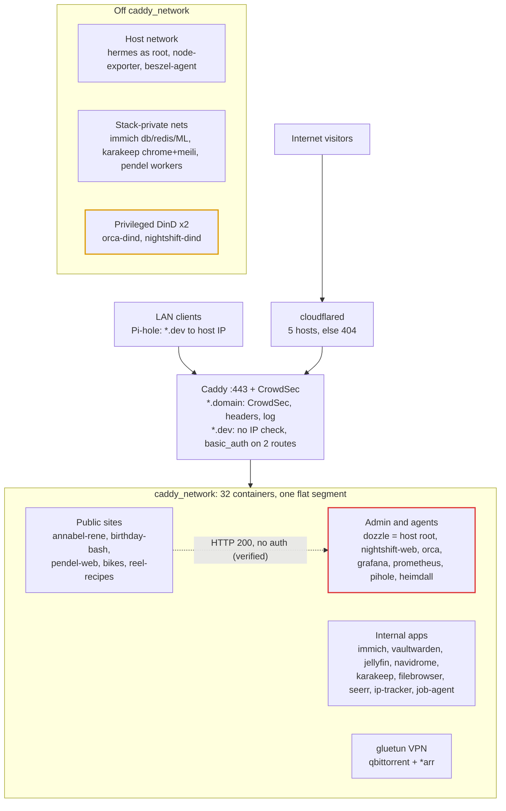

# Architecture review and hardening plan

Reviewed 2026-10-31, re-verified on the host 2026-11-09 and again 2026-11-16 (counts and evidence below are from the 16th).

**Status: phases 1 to 3 and step 4.1 were implemented on 2026-11-16.** The findings below describe the host as it was reviewed; the Status column and the ticks and notes in the plan say what changed. The diagram shows the state before the changes. What is left for Tim is listed at the end.

The edge is solid: no router ports are forwarded, only 5 hostnames go out through the Cloudflare Tunnel, and CrowdSec sits in front of them. The weak point is what happens *after* one container is compromised. 32 of the 52 containers share one flat Docker network (`caddy_network`), and the two agent runtimes can read every secret in `secrets/`.

The backup system (autorestic) is described as it stands. It is frozen, so no changes to it are proposed here.

## Architecture

Public hosts come in through the tunnel to `https://caddy:443`. LAN clients resolve `*.dev` through Pi-hole to the host IP. Caddy routes by Host header to container names on `caddy_network`. The *arr apps share gluetun's network namespace, so Caddy reaches them as `gluetun:<port>`.

### Where state lives

| Path | Holds | Backed up |
| --- | --- | --- |
| `/opt/dockerdata/<service>` | App state for every stack in this repo | Yes, weekly (Prometheus TSDB excluded) |
| `/mnt/storage/data` | Immich library, files served by filebrowser | Yes, weekly |
| `/mnt/storage/plexmedia` | Jellyfin, *arr and Navidrome media | No (re-downloadable) |
| `secrets/` | All stack env files | Yes, weekly |
| `~/nightshift/data`, `~/.hermes` | Nightshift runs, Hermes state | **No**: outside every autorestic location |

## Findings: security boundaries

| # | Finding | Evidence | Severity | Status 2026-11-16 |
| --- | --- | --- | --- | --- |
| 1 | 32 containers share `caddy_network`, including all 5 public sites. A compromised public app gets direct HTTP access to internal services. `reel-recipes` (added 2026-11-15) is the most exposed of the five: it runs yt-dlp, ffmpeg and whisper on downloaded media. Its URL allowlist (Instagram hosts only) and write password limit who can feed it, not what a malicious video can do to the parsers. | From `reel-recipes` and `pendel-web`: `dozzle:8080`, `vaultwarden:80`, `gluetun:8989`, `prometheus:9090`, `crowdsec:8080`, `orca:6768`, `nightshift-web:8080`, `job-agent:8765`, `heimdall:80` all return 200. | Critical | Fixed (3.1). The five public sites and cloudflared are on `public_network`. From `reel-recipes`, the internal names no longer resolve and their addresses time out. Residual: blackbox-exporter is on both networks. |
| 2 | Dozzle (shell + actions on a read-write socket) and the Nightshift dashboard are protected only by Caddy `basic_auth`. Container-to-container traffic never goes through Caddy. | From `reel-recipes`, with no credentials: `dozzle:8080/api/events/stream` streams the container list and `nightshift-web:8080/api/runs` returns the run list. | Critical | Fixed for Dozzle (1.2, 3.2): no shell, no actions, no socket, and unreachable from the public sites. Open for Nightshift: its dashboard still answers any container on `caddy_network` without credentials (3.3). |
| 3 | Agent runtimes can read all secrets. `orca` and `orca-dind` mount `~/coding` read-write; `nightshift-orchestrator` and `nightshift-web` mount it read-only. Both trees include `homelab/secrets/`. `nightshift-web` is also the unauthenticated dashboard from finding 2, so a file-read bug in it would expose the secrets to any container on `caddy_network`. | `secrets/.caddy.env` (Cloudflare API token) is readable in `orca` and `nightshift-web`. The `orca` service account can write `compose/caddy/Caddyfile`, which the host later deploys. It can also write `scripts/pihole-exporter-watchdog.sh` and `scripts/vpn-egress-check.sh`, which tim's crontab runs from this tree every 2 and 10 minutes (tim is in the `docker` group), and `autorestic/autorestic.sh`, which root's crontab runs weekly. So an Orca agent is host root within minutes, without touching DinD. | Critical | Orca half fixed (2.1): the stack is gone. Open: the secrets must still be rotated, and Nightshift still mounts `~/coding` read-only (3.3). |
| 4 | Two privileged DinD daemons. Anything that can reach their API can start a privileged container that sees host devices. | `Privileged=true` on `orca-dind` and `nightshift-dind`. | High | One of two removed (2.1). `nightshift-dind` remains (3.3). |
| 5 | `hermes` runs as root on the host network, from a stack outside this repo. | It listens on 127.0.0.1 only. | Medium | Open (3.3, outside this repo). |
| 6 | `filebrowser` has read-write access to all of `/mnt/storage/data`, Immich originals included. | Bind mount `/mnt/storage/data -> /srv` rw. | Medium | Fixed (3.4): `Immich/` is mounted read-only over the read-write parent. |
| 7 | The `*.dev` block has no source check. Only DNS and the tunnel's ingress list keep it LAN-only, so one wildcard ingress rule would publish it. | No `remote_ip`/header matcher and no CrowdSec in the `*.dev` block. | Medium | Fixed (1.3): the block aborts anything not from `192.168.0.0/16`. |
| 8 | No container sets `no-new-privileges`, and there is no userns-remap. | 0 of 52 containers. | Low | Open (3.5, needs sudo). Only `dozzle-socket-proxy` sets it. |
| 9 | gluetun's control server (`:8000`) is reachable from every container on `caddy_network`, and v3.41.3 still serves its legacy routes without authentication. Nothing in this repo uses it. | `GET gluetun:8000/v1/vpn/status` returns 200 from `reel-recipes`; `/v1/vpn/settings` returns 401. The legacy set is documented to include `PUT /v1/vpn/status` (stops the VPN). That was not tested, because it would take the tunnel down. The kill switch means the worst case is an outage, not an IP leak. | Low | Fixed (1.4): `gluetun:8000` refuses connections. |
| 10 | Visitors choose their own `client_ip`. Caddy trusts `X-Forwarded-For` from private ranges and reads it left to right, and Cloudflare appends the real address to whatever the visitor sent. CrowdSec's log parser and the Caddy bouncer both key on that value, so a banned visitor gets back in by adding one header, and scenarios never accumulate against a rotating fake address. | A request through the tunnel with `X-Forwarded-For: 203.0.113.77` was logged with `client_ip` 203.0.113.77 (2026-11-16). `Cf-Connecting-Ip`, which Cloudflare overwrites, is present on the same request. | High | Fixed (1.1): the same spoofed request is now logged with the `Cf-Connecting-Ip` address. |
| 11 | A container on `caddy_network` can also go through Caddy: `https://caddy` with a `*.dev` host name gets every internal route, the same as a LAN client. Splitting the network does not close this on its own. | Follows from finding 7: the `*.dev` block accepts any source. Not probed. | Medium | Fixed (1.3): a container asking `https://caddy` for a `*.dev` host gets a reset. |
| 12 | The host has global IPv6 addresses, and Docker publishes 53, 80 and 443 on `[::]`. Docker-published ports bypass ufw, so only the router's IPv6 firewall keeps Pi-hole from being an open resolver and Caddy from being reachable without the tunnel. | `ss` shows `[::]:53`, `[::]:80`, `[::]:443`. Reachability from outside was not tested. | Verify | Open (3.6, needs a test from outside). |
| 13 | 12 of the env files in `secrets/` are mode 664 (world-readable); the rest are 600. | `stat` on `secrets/.*.env`. | Low | Fixed (1.5): all env files and their backups are 600. |
| 14 | `job-agent` drives a headless browser against external job sites as root, sits on `caddy_network`, and serves an unauthenticated dashboard. It is an internal app with a public-app risk profile. | `shm_size: 1gb`, no `user:`, `job-agent:8765` returns 200 from `reel-recipes`. | Medium | Partly. It can no longer be reached from the public sites (3.1). It still runs as root: the image does not work as another user (3.4). |

Already in good shape: no forwarded ports, explicit tunnel ingress with a 404 fallback, SSH with keys only on a non-default port, node-exporter bound to docker0, Prometheus on localhost, *arr egress forced through gluetun with health-gated startup, karakeep-chrome isolated on its stack network.

## Findings: duplicate, overlapping and stray pieces

| Overlap | What overlaps | Suggestion |
| --- | --- | --- |
| Host and container metrics | Beszel + beszel-agent vs node-exporter + cAdvisor + Grafana | Done (2.2): Beszel is removed. |
| Traffic analytics | GoAccess vs Caddy per-host metrics in Grafana | Done (2.3): GoAccess is removed. |
| Agent runtimes | orca, nightshift, hermes, job-agent: 4 runtimes, 2 privileged DinD daemons | Orca is removed (2.1), which leaves 3 runtimes and 1 DinD daemon. |
| Stacks outside the repo | `~/nightshift`, `~/coding/hermes-agent` | Bring them under `compose/` so `check.sh`, Renovate, the README table and `/opt/dockerdata` apply. |
| Hand-kept service lists | Caddyfile routes, blackbox probe list, Heimdall tiles, README table | Done for the probe list (4.1): `check.sh` fails on drift. The tiles are now `compose/core/homepage/services.yaml`, in the repo but still unchecked. |
| Stray state | Anonymous Docker volume at Navidrome's `/music`. `plexmedia` is named after a Plex that no longer runs. | Drop the anonymous volume. The rename is optional. |

Media is not duplicated: Jellyfin serves Movies and Shows, and Navidrome is the only music server.

## Structure: easy and fast

The layout is sound: one directory per stack, one env file per stack, one validation script, Renovate for versions. Three things work against "easy" and "fast".

**The deploy tree is also the work tree.** `~/coding/homelab` is where branches get checked out, where Orca agents write, where cron runs scripts from, and where `restart-services.sh` deploys from. On 2026-11-16 the checkout sat on a branch 22 commits behind `main`: a redeploy would have dropped the public `rezepte` route and rolled back about 20 image bumps. A separate deploy checkout outside `~/coding` (for example `/opt/homelab`, always on `main`, holding `secrets/`) fixes that, the cron path in finding 3 and the secrets exposure in one move. It changes the path autorestic backs up for secrets, so it needs a decision on the freeze. The cheap interim is a guard in `restart-services.sh` that refuses to run unless the tree is clean and on `main`.

**The host is a 2-core Celeron G3900T running 52 containers.** Memory is fine (22 of 31 GiB available). CPU is the limit: load average sits around 2 at idle. Every always-on container that duplicates another one costs speed. Candidates, cheapest first: Beszel and its agent, GoAccess, Heimdall if the tiles are unused, and three of the four agent runtimes. cAdvisor is the second-largest idle CPU user; a longer `--housekeeping_interval` is free. `reel-recipes` runs whisper on CPU, so one transcription takes a core for its duration.

**Too many hand-kept lists and one very long instruction file.** A new service touches the Caddyfile, the probe list, the README table, Heimdall and the env example. `check.sh` already catches most drift; the probe list is the gap (phase 4.1). `CLAUDE.md` has grown into an incident log; moving the history into `docs/` would leave a short file that states the rules.

Smaller strays: the CI workflow has no `permissions:` block (add `contents: read`), and CrowdSec lists 12 bouncer registrations where one is live.

## Traffic monitoring and bot detection

Web bots on the public sites are already covered; raw traffic is not watched at all. Add Suricata on the host and feed its alerts into the existing CrowdSec (phase 4.4). A tool on the host sees only the host's own packets, so the rest of the LAN needs a mirror port (phase 4.4).

| Layer | Covered today by | Gap |
| --- | --- | --- |
| Public web bots | CrowdSec on Caddy's access log, with `base-http-scenarios` and `http-cve` enabled. The real visitor IP survives the tunnel as `client_ip`. | Cloudflare Bot Fight Mode at the edge is unchecked. |
| LAN devices (malware, beaconing) | Pi-hole sees every DNS query on the LAN. | No alerting on odd query patterns; nothing below DNS. |
| Host bandwidth | node-exporter and cAdvisor in Grafana | Volume only: no flows, no signatures. |
| Host packets | Nothing | Scans, exploit attempts, miner and C2 callbacks are invisible. |
| Rest of the LAN | Nothing | The router forwards phone-to-internet traffic without it ever reaching the host. |

Suricata on the host cannot see inside the tunnel. Tunnelled traffic is an encrypted outbound connection to Cloudflare, so public-bot detection stays at the Caddy and Cloudflare layers. Zeek and Security Onion were considered and rejected as too heavy for one host.

Open question: does the switch support port mirroring? That decides whether the mirror-port half of phase 4.4 is possible.

## Plan

Decided 2026-11-16: Orca is removed as a whole, and Heimdall is replaced by Homepage. The phases are ordered so that each one leaves the host working and none of phases 1–3 touch the backup system. Run `./scripts/check.sh` after every phase and deploy from a clean checkout of `main`.

### Phase 1: quick fixes (about 1 h, low risk)

- [x] **1.1 Take the client address from Cloudflare** (finding 10). In the Caddyfile's `servers` block add `client_ip_headers Cf-Connecting-Ip X-Forwarded-For` and `trusted_proxies_strict`. Force-recreate caddy, repeat the spoofed-header request, and confirm the log shows the real address.
  - Done. Before the change the spoofed request was logged with `client_ip` 203.0.113.77; after it, with the value of `Cf-Connecting-Ip`.
- [x] **1.2 Defang Dozzle** (finding 2). Set `DOZZLE_ENABLE_SHELL` and `DOZZLE_ENABLE_ACTIONS` to false. Dozzle still holds the full Docker API, and a `:ro` socket mount does not change that: read-only applies to the socket file, not to the API calls sent through it. Phase 3 puts a socket proxy in front.
- [x] **1.3 Guard `*.dev`** (findings 7 and 11). `@outside not remote_ip 192.168.0.0/16` followed by `abort @outside` at the top of the `*.dev` block. Docker networks are in 172.16.0.0/12, so this rejects the tunnel and every container while LAN clients keep working. First check that no container calls a `*.dev` name itself (Beszel's hub URL, Seerr's Jellyfin URL).
  - Done, with one change: the guard is `handle @outside { abort }` as the first `handle`. A bare `abort @outside` would never run, because Caddy orders `abort` after the `handle` blocks.
  - The assumption was checked first with a temporary access log on the block (since removed). A phone browser and the Bitwarden app arrived from 192.168.x.x over HTTP/2 and HTTP/3. Containers arrived from 172.x, whether they dialled `caddy` directly or resolved the name through Pi-hole. The only container calling `*.dev` names was Heimdall, for its tile statistics, and it is gone.
  - Side effect: from the host, a request forced to 127.0.0.1 is refused too, because loopback traffic reaches Caddy from the bridge gateway. Requests to the host name work.
  - Still to do: confirm from a laptop and a phone that the internal UIs open.
- [x] **1.4 Bind gluetun's control server to localhost** (finding 9). `HTTP_CONTROL_SERVER_ADDRESS=127.0.0.1:8000` in `.arr.env`.
  - Done, but in `compose/arr/compose.yaml` instead of `.arr.env`: the setting is not a secret, and a tracked line survives a rebuilt env file. The six apps answer on `gluetun:<port>` and `vpn-egress-check.sh` passes.
- [x] **1.5 Tighten file modes and the deploy script** (finding 13). `chmod 600 secrets/.*.env`. Add a guard to `restart-services.sh` that refuses to run unless the tree is clean and on `main`.
  - Done. The `.env.bak-*` copies are 600 as well. The guard is overridden with `--force` or `ALLOW_DIRTY_DEPLOY=1`. Only the guard block was exercised; the script itself was not run.

### Phase 2: remove what is not needed (about 2 h, low risk)

- [x] **2.1 Remove Orca** (findings 3 and 4, Orca half). This closes the cron path to host root, removes the read-write mount of `~/coding`, and removes one of the two privileged DinD daemons.
  1. `docker compose -f compose/orca/compose.yaml down`, then `docker image rm orca-ade` and the unused `docker:*-dind` tags (about 3.5 GB).
  2. Delete `compose/orca/`, `secrets/.orca.env.example`, the `@orca` route in the Caddyfile, the orca probe in `prometheus.yml`, the README row, and the Orca section of `CLAUDE.md`.
  3. Revoke what the container held: the `gh` device-flow token (GitHub → Settings → Applications), the Claude Code login, and the paired Orca devices. Then delete `/opt/dockerdata/orca`.
  4. Rotate every secret in `secrets/`, starting with the Cloudflare API token. Agents could read them all, so treat them as exposed.
  5. The Orca exclude in `autorestic/.autorestic.yml` goes stale. It is harmless; leave it while the backup system is frozen.
  - Items 1 and 2 are done: containers, network, the `orca-ade` image and four unused `docker:*-dind` tags are gone (`docker:29.7.2-dind` stays, `nightshift-dind` runs on it). **Items 3 and 4 are open and are Tim's**: revoke the tokens, delete `/opt/dockerdata/orca`, rotate the secrets. The untracked `secrets/.orca.env` is still there; it holds versions and paths, no credentials.
- [x] **2.2 Remove Beszel and its agent.** node-exporter, cAdvisor and Grafana already cover it. That drops one socket mount and one host-network container.
  - Done. The data directories are left in place: `/opt/dockerdata/beszel_data`, `/opt/dockerdata/beszel_agent_data`, `/mnt/storage/.beszel`.
- [x] **2.3 Remove GoAccess** unless its per-path and visitor views get used. CrowdSec reads the log either way.
  - Done. Nothing mounts the GeoLite2 database any more, so `check.sh` no longer requires it. Left in place: `/opt/dockerdata/caddy/goaccess` and `/opt/dockerdata/caddy/geoip`.
- [x] **2.4 Replace Heimdall with Homepage** (`ghcr.io/gethomepage/homepage`, pinned). Its whole configuration is YAML, so the tiles live in `compose/core/homepage/` and stop being a hand-kept list outside the repo.
  - Keep the real domain out of the tracked files: Homepage substitutes `{{HOMEPAGE_VAR_DOMAIN}}` from the environment, and it needs `HOMEPAGE_ALLOWED_HOSTS` set to its own host name.
  - Do not give it the Docker socket. Use static `services.yaml` entries with `siteMonitor` for up/down status, and add app widgets (Pi-hole, Immich, the *arr apps, Jellyfin) one at a time with read-only API keys in `secrets/.core.env`.
  - Keep the route name or add a new one, update the probe line and the README row, then remove the Heimdall service and `/opt/dockerdata/heimdall`.
  - If Homepage feels heavy on this CPU, Glance is the lighter option: one Go binary, also YAML, fewer app widgets.
  - Done with v2.8.0 at `home.dev`; nothing answers at the old Heimdall name. 24 static tiles in five groups, each with `siteMonitor`. The config directory is mounted read-only, the container runs as `${PUID}:${PGID}` with `LOG_TARGETS=stdout`, and it has no socket and no `env_file`. The public sites are monitored through their public URL, because Homepage is not on `public_network`. No app widgets yet. `/opt/dockerdata/heimdall` is left in place.

### Phase 3: isolate what is left (half a day, medium risk)

- [x] **3.1 Put the public sites on their own network** (finding 1). Create `public_network`. cloudflared and the 5 public sites join it and leave `caddy_network`; Caddy joins both. Blackbox-exporter joins it too so the probes keep working. A compromised public app can then reach Caddy and the other public sites, and nothing else. This is about eight file edits, and it replaces the four-network split.
  - Done. From inside `reel-recipes`, `dozzle`, `vaultwarden`, `nightshift-web`, `prometheus`, `gluetun`, `pihole` and `job-agent` do not resolve, and their addresses time out.
  - Not in the plan: Prometheus could no longer scrape `cloudflared:2000`. Caddy's `:2020` metrics listener now relays it at `/cloudflared/metrics`, so Prometheus did not have to join `public_network`.
  - Residual: blackbox-exporter is on both networks and answers on `:9115` to the public sites. It returns probe results, not response bodies. A second exporter for the public side would close that.
  - `check.sh` now fails if a Caddy upstream shares no network with Caddy, or if anything other than Caddy and blackbox-exporter is on both networks.
  - `bikes` rebuilds its site before it listens, so moving it took it offline for the length of that build. The same happens on every restart of that container.
- [x] **3.2 Socket proxy for Dozzle** (finding 2). A docker-socket-proxy that allows container list, logs and events, on a network only Dozzle shares.
  - Done with `wollomatic/socket-proxy` 1.13.2, which takes a regex per HTTP method. Allowed: GET on ping, version, info, events, the container list, and per-container inspect, logs and stats. Dozzle lists all containers and streams logs. Through the proxy, stop, exec and delete return 405, and file-archive and image-list reads return 403. Dozzle's disk-usage call (`/system/df`) is blocked too; that only costs one figure in its UI.
- [ ] **3.3 Nightshift and Hermes** (findings 2–5). *Not done: both stacks live outside this repo. See "Left for Tim".* Mount only the repositories Nightshift works on, not all of `~/coding`, or put a tmpfs over `/coding/homelab/secrets`. Run Hermes as a non-root user. Decide whether both stacks move under `compose/`; that brings `check.sh` and Renovate, and moving their state to `/opt/dockerdata` puts it into the backup, which needs a decision given the freeze. Replacing `nightshift-dind` with a Sysbox-run daemon is the last step, and only worth it if Nightshift stays.
- [ ] **3.4 Narrow filebrowser and job-agent** (findings 6 and 14). Read-only on `Immich/` for filebrowser. A non-root `user:` for `job-agent`.
  - filebrowser: done. `/srv/Immich` is a read-only mount over the read-write `/srv`; a write there fails with "Read-only file system". Immich's own mount is unchanged.
  - job-agent: not done. The image defines no user, and as uid 1000 it fails at start: uv cannot create its cache, and with a writable home `botasaurus_requests` cannot write into `site-packages`. The data directory is owned by root as well. The fix is a `USER` in the app's Dockerfile and a `chown` of `/opt/dockerdata/job-agent`.
- [ ] **3.5 `no-new-privileges` for every container** (finding 8). One line, `"no-new-privileges": true`, in `/etc/docker/daemon.json`. It needs a daemon restart, so do it with a full `restart-services.sh` pass and check the LinuxServer images, which switch users at startup.
- [ ] **3.6 Test IPv6 from outside** (finding 12). If 53, 80 or 443 answer on the host's IPv6 address, publish them on the IPv4 address only.

### Phase 4: keep it easy (optional)

- [x] **4.1 Fail `check.sh` on probe-list drift**, so a new Caddy route without a blackbox probe is caught.
  - Done: every `reverse_proxy` upstream must have a probe with the same host and port. Tested by removing one probe line.
- [ ] **4.2 Deploy from a checkout outside `~/coding`** holding `secrets/`. Needs the backup decision, because autorestic's `secrets` location points at the current path.
- [ ] **4.3 Shorten `CLAUDE.md`**: move the incident history into `docs/`.
- [ ] **4.4 Traffic monitoring**: a Suricata stack feeding CrowdSec (host network, `NET_ADMIN` and `NET_RAW` only, ET Open rules, the `crowdsecurity/suricata` collection), then a mirror port for the rest of the LAN if the switch supports one. On a 2-core host, measure Suricata's CPU cost before keeping it.

After phases 1–3 the host runs about 48 containers instead of 52, no agent has a read-write mount of the deploy tree, and a compromised public site reaches only Caddy.

As of 2026-11-16 that is the case: 48 containers run, 23 of them on `caddy_network` and 8 on `public_network`.

### Left for Tim

- **Rotate every secret in `secrets/`** (2.1 item 4), Cloudflare API token first. Orca agents could read them all until today.
- **Revoke what Orca held** (2.1 item 3): its `gh` device-flow token, its Claude Code login, and its paired devices.
- **Delete the data of removed services** (root-owned, needs sudo): `/opt/dockerdata/orca`, `/opt/dockerdata/heimdall`, `/opt/dockerdata/beszel_data`, `/opt/dockerdata/beszel_agent_data`, `/opt/dockerdata/caddy/goaccess`, `/opt/dockerdata/caddy/geoip`, `/mnt/storage/.beszel`.
- **3.3**: in `~/nightshift/compose.yaml`, mount only the repositories Nightshift works on instead of all of `~/coding`, or put a tmpfs over `/coding/homelab/secrets` in both containers. Take `nightshift-web` off `caddy_network` or give the app its own login, because Caddy's `basic_auth` does not cover container-to-container calls. Give Hermes a non-root `user:`.
- **3.4**: the job-agent image needs a non-root user before compose can set one.
- **3.5**: `no-new-privileges` in `/etc/docker/daemon.json`, then a daemon restart.
- **3.6**: the IPv6 test from outside.
- **Confirm from a laptop and a phone** that the `*.dev` sites open (1.3), that `home.dev` shows the tiles, and that Dozzle shows logs after its login.

Out of scope on purpose: the autorestic config and schedule, and an offsite copy (the backup system is frozen).
