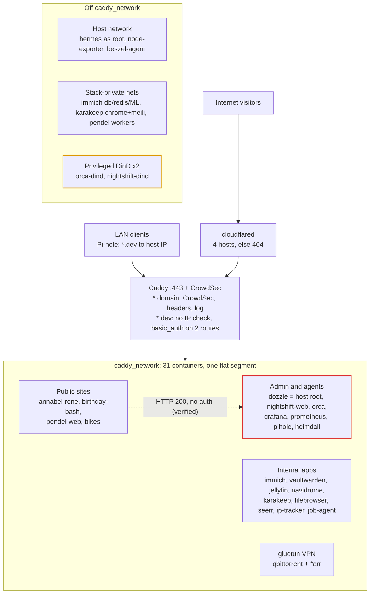

# Architecture review and hardening plan

Reviewed 2026-10-31, re-verified on the host 2026-11-09.

The edge is solid: no router ports are forwarded, only 4 hostnames go out through the Cloudflare Tunnel, and CrowdSec sits in front of them. The weak point is what happens *after* one container is compromised. 31 of the 51 containers share one flat Docker network (`caddy_network`), and two agent sandboxes can read every secret in `secrets/`.

The backup system (autorestic) is described as it stands. It is frozen, so no changes to it are proposed here.

## Architecture

Public hosts come in through the tunnel to `https://caddy:443`. LAN clients resolve `*.dev` through Pi-hole to the host IP. Caddy routes by Host header to container names on `caddy_network`. The *arr apps share gluetun's network namespace, so Caddy reaches them as `gluetun:<port>`.

### Where state lives

| Path | Holds | Backed up |
| --- | --- | --- |
| `/opt/dockerdata/<service>` | App state for every stack in this repo | Yes, weekly (Prometheus TSDB excluded) |
| `/mnt/storage/data` | Immich library, files served by filebrowser | Yes, weekly |
| `/mnt/storage/plexmedia` | Jellyfin, *arr and Navidrome media | No (re-downloadable) |
| `secrets/` | All stack env files | Yes, weekly |
| `~/nightshift/data`, `~/.hermes` | Nightshift runs, Hermes state | **No**: outside every autorestic location |

## Findings: security boundaries

| # | Finding | Evidence | Severity |
| --- | --- | --- | --- |
| 1 | 31 containers share `caddy_network`, including all 4 public sites. A compromised public app gets direct HTTP access to internal services. | From `pendel-web`: `dozzle:8080`, `vaultwarden:80`, `gluetun:8989`, `prometheus:9090`, `crowdsec:8080`, `orca:6768`, `nightshift-web:8080` all return 200. | Critical |
| 2 | Dozzle (shell + actions on a read-write socket) and the Nightshift dashboard are protected only by Caddy `basic_auth`. Container-to-container traffic never goes through Caddy. | Both return 200 to an unauthenticated request from `pendel-web`. | Critical |
| 3 | Agent sandboxes can read all secrets. `orca` mounts `~/coding` read-write and `nightshift-orchestrator` mounts it read-only; both trees include `homelab/secrets/`. | `secrets/.caddy.env` (Cloudflare API token) is readable in both. Orca can also edit the compose files and Caddyfile the host later deploys. | High |
| 4 | Two privileged DinD daemons. Anything that can reach their API can start a privileged container that sees host devices. | `Privileged=true` on `orca-dind` and `nightshift-dind`. | High |
| 5 | `hermes` runs as root on the host network, from a stack outside this repo. | It listens on 127.0.0.1 only. | Medium |
| 6 | `filebrowser` has read-write access to all of `/mnt/storage/data`, Immich originals included. | Bind mount `/mnt/storage/data -> /srv` rw. | Medium |
| 7 | The `*.dev` block has no source check. Only DNS and the tunnel's ingress list keep it LAN-only, so one wildcard ingress rule would publish it. | No `remote_ip`/header matcher and no CrowdSec in the `*.dev` block. | Medium |
| 8 | No container sets `no-new-privileges`, and there is no userns-remap. | 0 of 51 containers. | Low |

Already in good shape: no forwarded ports, explicit tunnel ingress with a 404 fallback, SSH with keys only on a non-default port, node-exporter bound to docker0, Prometheus on localhost, *arr egress forced through gluetun with health-gated startup, karakeep-chrome isolated on its stack network.

## Findings: duplicate, overlapping and stray pieces

| Overlap | What overlaps | Suggestion |
| --- | --- | --- |
| Host and container metrics | Beszel + beszel-agent vs node-exporter + cAdvisor + Grafana | Remove Beszel. That also drops one socket mount and one host-network container. |
| Traffic analytics | GoAccess vs Caddy per-host metrics in Grafana | Keep only if its per-path and visitor views get used. CrowdSec reads the log either way. |
| Agent runtimes | orca, nightshift, hermes, job-agent: 4 runtimes, 2 privileged DinD daemons | One sandbox pattern, or at least one shared hardened DinD. |
| Stacks outside the repo | `~/nightshift`, `~/coding/hermes-agent` | Bring them under `compose/` so `check.sh`, Renovate, the README table and `/opt/dockerdata` apply. |
| Hand-kept service lists | Caddyfile routes, blackbox probe list, Heimdall tiles, README table | Generate the probe list from the Caddyfile in `check.sh`, or fail on drift. |
| Stray state | Anonymous Docker volume at Navidrome's `/music`. `plexmedia` is named after a Plex that no longer runs. | Drop the anonymous volume. The rename is optional. |

Media is not duplicated: Jellyfin serves Movies and Shows, and Navidrome is the only music server.

## Plan

Do steps 1–3 first. Together they close the public-app-to-host-root path, and none of them touch the backup system.

- [ ] **1. Defang Dozzle** (finding 2, 15 min, low risk). Set `DOZZLE_ENABLE_SHELL`/`DOZZLE_ENABLE_ACTIONS` to false and mount the socket `:ro`, or put a docker-socket-proxy in front that allows only container list and logs.
- [ ] **2. Split `caddy_network`** (findings 1–2, 2–3 h, medium risk). Use four networks: `edge` (caddy, cloudflared, crowdsec), `public` (caddy + the 4 public sites), `apps` (caddy + internal apps), `admin` (caddy + dozzle, grafana, orca, nightshift-web, pihole UI). Stack-private networks get `internal: true`. Blackbox-exporter joins each network it probes, and `check.sh`'s upstream check learns the network map.
- [ ] **3. Hide `secrets/` from the agents** (finding 3, 1 h + rotation, low risk). Put a tmpfs over `/home/tim/coding/homelab/secrets` in `orca` and `orca-dind`, and over `/coding/homelab/secrets` in the `nightshift-*` services. Mount the homelab repo read-only in orca. Then rotate the Cloudflare token and every other secret an agent could have read. The secrets stay in place, so autorestic's paths do not change.
- [ ] **4. Replace the two privileged DinD sidecars** (finding 4, half a day, medium risk). Use one daemon under the Sysbox runtime, which runs DinD without `--privileged`. Orca's same-path bind of `CODING_DIR` must still hold.
- [ ] **5. Tunnel guard on `*.dev`** (finding 7, 10 min, low risk). `@tunnelled header Cf-Connecting-IP *` followed by `abort @tunnelled`, so a mistaken wildcard ingress fails closed.
- [ ] **6. Hermes as non-root, and both outside stacks into `compose/`** (finding 5, 1–2 h, low risk). Moving their state into `/opt/dockerdata` also puts it into the existing backup without editing the backup config. That needs an explicit decision, given the freeze.
- [ ] **7. Narrow filebrowser** (finding 6, 15 min, low risk). Read-only on `Immich/`, or scope it to a share subfolder.
- [ ] **8. Remove Beszel (and GoAccess if unused); add `no-new-privileges`** through a shared YAML anchor, one stack at a time (finding 8, 1 h, low risk). Test LinuxServer images, which switch users at startup.
- [ ] **9. Generate the blackbox probe list from the Caddyfile** in `check.sh`, or fail on drift (1–2 h, low risk).

Out of scope on purpose: the autorestic config and schedule, and an offsite copy (the backup system is frozen).
